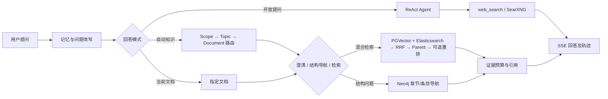
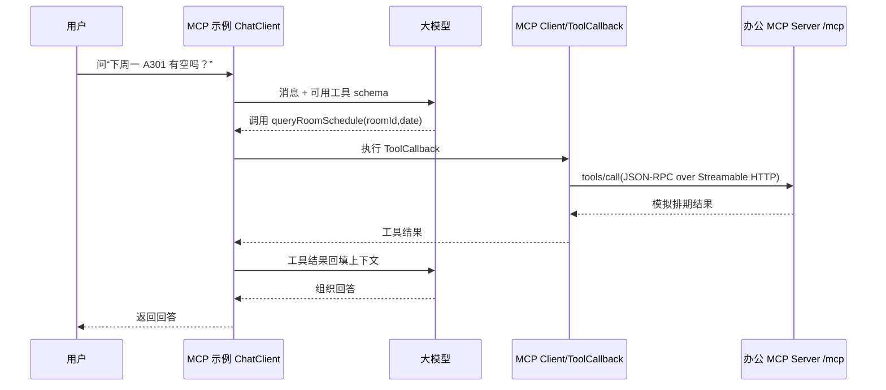

# Nexus Agent 面试指南（Java 后端 / AI 应用开发）

> 以当前简历和本地源码为依据。代码能证明功能存在，不能证明个人贡献。面试时把“我负责”限定在自己实际开发、联调、排障过的部分；没有测量过的提升幅度、成功率和吞吐量不要编造。主业务聊天 Agent 与 `ai-example-mcp` 独立示例要分开讲。

## 一、怎么介绍项目

### 30 秒版本

> Nexus Agent 是面向企业多文档知识问答和开放式对话的系统。它把文档上传、异步解析和索引、知识范围路由、向量与关键词混合检索、证据引用和流式回答串成一条链路。文档问题会先定位知识范围，再用 RRF 融合检索结果；开放式实时问题交给 ReAct Agent，通过本地 SearXNG 获取网页信息。系统还用 Redis 会话租约、调用限次和执行轨迹控制并发与工具调用。

### 90 秒版本

> 项目主要解决四类问题：企业文档多、用户不知道问题属于哪份文档；单一路径检索容易漏掉专有名词或语义相近内容；长文档回答缺少足够上下文和可核对的出处；开放式 Agent 与流式对话需要并发和调用边界。文档上传后，MinIO 保存原件，Kafka 驱动解析和索引任务，Parent/Child 切块分别承担上下文保留和精细匹配。问答前置编排会装载记忆、改写问题，并在自动知识模式下按 Scope→Topic→Document 路由；歧义问题先澄清，章节位置问题优先走 Neo4j 结构导航，其余走 PGVector 与 Elasticsearch 双路召回、RRF 融合、Parent 回升和可选重排，最终按证据预算生成带引用的回答。开放式问题走 ReAct Agent；联网工具从 Tavily 换为本地 SearXNG。输出用 SSE 推送，同一会话用 Redis Lua 租约避免并发执行，并记录工具及阶段轨迹以便排障。

讲完停下来，让面试官选择追问方向。可以接一句：“我可以重点讲知识路由、混合检索、联网工具替换或流式并发控制。”

**讲述边界：**“五步前置编排”是对处理环节的概括，不代表每个问题固定执行五次模型调用。开放提问在装载记忆后直接走 ReAct；自动知识与指定文档模式才继续走改写、路由和文档执行计划。

## 二、Agent 高频基础题：用“定义 → 原理 → 项目落点”回答

| 面试题 | 建议回答 |
| --- | --- |
| Agent、普通聊天、工作流、RAG 有什么区别？ | 普通聊天主要由模型直接生成；工作流由程序预先规定步骤；RAG 在生成前引入外部证据；Agent 允许模型在受控循环中决定是否调用工具、如何利用结果。项目将文档问答交给确定性检索链路，开放提问交给 ReAct Agent，避免所有问题都自由探索。 |
| ReAct 是什么？ | 核心是“模型提出下一步行动 → 调用工具 → 把观察结果回填给模型 → 继续决策/回答”的循环。工程上应限制模型轮次和工具次数，处理工具失败，记录每轮输入、输出及耗时。本项目的 `ReactAgent` 配有模型/工具调用上限与工具重试。 |
| Function Calling 的调用者是谁？ | 模型根据工具名称、描述和参数 schema 生成结构化调用意图；宿主程序校验参数、执行工具，把结果作为工具消息交还模型。模型不直接访问数据库或 HTTP 服务。参数 schema、权限和副作用控制由应用负责。 |
| MCP 与 Function Calling 有什么关系？ | Function Calling 是模型侧提出工具调用的机制；MCP 是宿主与外部服务之间用于发现和调用工具等能力的协议。MCP 客户端可以把远端工具适配成 Spring AI 的 `ToolCallback`，再交给模型使用。主业务的 SearXNG 工具是本地 `ToolCallback`，不是 MCP 工具。 |
| MCP 的角色与能力有哪些？ | Host 是承载模型交互的应用，Client 负责连接某个 Server，Server 提供工具、资源、提示模板。工具由模型决定调用；资源由应用读取；提示模板通常由用户选择。示例只实现了 **Tools**。协议消息使用 JSON-RPC；当前示例通过 Streamable HTTP `/mcp` 通信。详见 [MCP 工具规范](https://modelcontextprotocol.io/specification/2025-11-25/server/tools) 与 [传输规范](https://modelcontextprotocol.io/specification/2025-11-25/basic/transports)。 |
| `tools/list` 和 `tools/call` 做什么？ | 前者返回工具名称、描述与输入 schema，客户端据此构造可用工具；后者携带工具名与参数执行调用，得到内容或错误。示例的 Spring AI starter/SDK 封装了这些协议细节，手写客户端显式调用 `initialize()`。参见 [MCP 工具规范](https://modelcontextprotocol.io/specification/2025-11-25/server/tools) 和 [生命周期规范](https://modelcontextprotocol.io/specification/2025-11-25/basic/lifecycle)。 |
| MCP 的 Streamable HTTP 和聊天 SSE 一样吗？ | 不一样。前者是 MCP Client 与 Server 之间的协议传输，HTTP 响应可选用 SSE 承载服务端消息；后者是主业务后端向浏览器推送回答正文、状态、引用的应用接口。两者即使用到 SSE，也处在不同链路。 |
| 会话记忆与 Checkpoint 有何区别？ | 记忆解决“后续提问如何用到历史内容”，可由近期对话与长期摘要组成；Checkpoint 保存 Agent 图运行状态，用于状态持久化。项目的持久会话记忆与 `MysqlSaver` 是不同组件，不能说有 Checkpoint 就自动完成长期记忆压缩。 |
| 为什么需要调用上限和工具重试？ | 上限防止模型反复调用导致时延、成本和无效循环；重试只适合暂时性故障，且要限制次数、退避和超时。带副作用工具不能无条件重试，否则可能重复写入；示例会议室“预订”尚无真正的幂等保护。 |
| 如何减少幻觉？ | 文档问题先检索、过滤弱证据、保留引用标识，并限制进入 Prompt 的证据预算；无证据时走明确兜底。联网结果只包含搜索摘要，也需要检查来源和时间，不能把摘要当成已阅读全文。 |
| 外部网页或工具结果中的提示词注入怎么处理？ | 搜索结果和 MCP 工具返回值都是不可信数据，不能让其中的“忽略之前指令”改变系统规则。应隔离数据与指令、限制工具权限，并对有副作用的操作做鉴权、参数校验和审计。当前办公 MCP 示例没有完整实现这些生产控制。 |
| 什么时候用多 Agent？ | 只有任务确实需要独立角色、不同工具权限或可并行的专家分工时才考虑；多个 Agent 会增加上下文传递、成本与故障面。主业务代码是一个 ReAct Agent 配合前置编排与专用执行器，不能宣称实现了多 Agent 协作。 |
| 长对话的上下文怎么控制？ | 短期保留近期轮次，长期用摘要压缩旧对话，再按回答需要组装历史；要防止摘要丢失约束或把旧事实当成当前事实。项目的记忆装载和回答历史组装与 Agent Checkpoint 分开处理。 |
| 如何评估 Agent/RAG？ | 将任务按知识路由、检索、答案和工具调用拆开评估：路由正确率、Recall@K/NDCG、引用支持率、任务完成率、工具错误率与时延。先定义样本与基线，再报指标。本仓库没有可直接用于简历的完整对照评测数据，不报虚构百分比。 |

### 进阶高频题：面试官继续追问时怎么展开

**1. Agent 的“自主性”具体体现在哪里？它是否能控制整个系统？**

Agent 的自主性是指模型在应用提供的工具和规则范围内，决定下一步回复、调用哪个工具、给什么参数，以及是否根据工具结果继续行动。真正执行工具、限制次数、处理异常、持久化状态的仍是宿主程序。它不能越过未注册的工具访问数据库，也不应把工具返回的文字当成更高优先级的指令。本项目开放提问走 ReAct；文档范围路由和 RAG 是程序编排的受控路径，不能把整套系统称为“全自主 Agent”。

**2. ReAct 与一次性 Function Calling 有什么区别？**

一次性 Function Calling 描述一轮模型调用中产生的结构化工具请求；ReAct 描述“判断 → 行动 → 观察 → 再判断”的多轮执行方式。模型可能先搜索、读结果，再决定继续搜索或回答。执行循环容易因信息不足或工具失败反复尝试，所以需要最大模型调用数、工具调用数、超时、重试策略和退出条件。项目对模型调用设置每 run 8 次、每 thread 40 次，对 `web_search` 设置每 run 6 次、每 thread 30 次；这些是配置边界，不代表每个问题一定调用到上限。

**3. 工具描述和参数 Schema 为什么重要？**

模型看到的是工具名、描述和参数结构，而不是 Java 方法源码。描述决定模型何时选用工具，Schema 约束它应给出什么字段；宿主收到请求后还要进行校验，不能把模型生成的 JSON 当可信输入。`web_search` 的回调声明了 `WebSearchRequest`：`query` 应非空，`maxResults` 可选。若模型给错参数，问题可能出在工具描述、Schema、模型输出或适配层，排查时要看原始工具调用记录，而不是只看最终回答。

**4. 结构化输出与工具调用有什么区别？**

结构化输出关注“模型把答案按规定格式返回”，例如返回一个执行计划 JSON；工具调用关注“模型请求宿主执行一项动作”，会有工具执行和结果回填。即使两者都呈现 JSON，前者不自动产生外部副作用，后者可能搜索、写库或调用业务系统。项目的知识路由/执行计划属于前置编排产物，SearXNG 搜索才是真正的工具执行。面试时要说清“模型建议了什么”和“程序实际做了什么”。

**5. 为什么需要 Query 改写和子问题拆分？如何防止改写改错？**

用户会说“它的第二条是什么”“上面的流程怎么审批”，直接检索会丢失对象；改写利用近期会话把指代补全。复合问题可以拆成独立子问题，分别检索证据，再汇总回答。风险是模型把原问题中的型号、日期、否定词或范围改掉，因此应保留原始问题、记录改写前后内容，并检查关键约束是否仍在。本项目把改写放在文档问答前置编排，开放提问不必固定经过这一步。

**6. Embedding 召回与 Cross-Encoder 重排的原理差别？**

Embedding 通常分别将问题和文档片段编码为向量，用相似度快速从大量片段中召回候选；适合大规模近邻检索，但可能把主题相近却不回答问题的片段排前面。Cross-Encoder 把“问题 + 候选片段”共同送入模型进行相关性打分，通常更适合少量候选精排，代价是每个候选都要计算。项目用 PGVector 做向量召回，检索链路有重排能力；外部 HTTP Cross-Encoder 的单独开关目前是关闭的。面试时先讲算法角色，再讲当前实际配置。

**7. RRF 为什么适合融合向量与关键词检索？有什么缺点？**

PGVector 的相似度与 Elasticsearch 的词法得分不在同一量纲，直接加权求和需要标定。RRF 只用各通道排名：候选在某一路排得越靠前，得到的 `1/(k + rank)` 越大；多个通道命中会累加。本项目用 `k=60`，实现中的 `rank` 从 0 开始，因此公式写作 `1/(60 + rank + 1)`。缺点是即使一条候选绝对相关度很低，只要在一条短列表中排第一也能得分；所以项目在融合前设置弱证据过滤。

**8. 为什么长上下文模型不能完全替代 RAG？**

长上下文能容纳更多材料，但把全部企业文档塞入 Prompt 会增加传输、Token 成本与干扰，还面临文档更新和权限范围控制。RAG 先定位范围、召回证据，能控制输入规模并给出来源；代价是会引入检索漏召回、切块和排序错误。项目通过 Scope→Topic→Document 路由、Parent/Child、双路检索和证据预算解决的是“把相关证据挑出来并保留语境”，不是单纯追求更长的模型上下文。

**9. Chunk 太大或太小分别会怎样？为什么使用 Parent/Child？**

块太大容易混入多个主题，向量表示不够聚焦，重排和 Prompt 成本也高；块太小又会把步骤条件、表格标题与正文拆散，产生断章取义。Child 负责精确命中，Parent 负责回答时提供较完整的上下文。查询命中 Child 后按关联关系回升 Parent，再去重和裁剪。面试官追问“切块大小怎么定”，要回答用文档类型、结构边界、召回指标和证据支持率验证，而不是说某个固定字符数对所有文档最优。

**10. 超时、重试、降级和熔断有什么不同？**

超时限制单次等待；重试是在暂时性故障后再尝试；降级是在某一通道失败后用剩余能力继续服务；熔断是在持续失败时暂时不再请求故障依赖。项目里搜索工具配置了有上限的重试和退避，RAG 某检索通道超时可按空结果降级。不能因为有重试就说实现了熔断；会议室预订这类写操作更不能随意重试，否则可能重复执行。面试时要分清“当前代码已有”和“生产改进建议”。

**11. “支持并行工具”是否表示现在同时调用多个不同工具？**

不是。Agent 配置了 `parallelToolExecution(true)` 和 `maxParallelTools(4)`，表示执行器具备并行工具调用的配置；当前主 Agent 只注册了一个 `web_search` 工具。即便同一轮模型生成多个工具请求，实际并发还取决于模型输出、框架调度和工具线程资源。因此简历可以说“配置了并行工具执行上限”，不要据此宣称主业务已经接入四种工具或实测四路同时调用。

**12. MCP 的“动态发现”是不是工具热插拔？**

不是一回事。MCP 客户端连接服务端后可获得工具名、描述和输入 Schema，并将远端工具适配为 `ToolCallback`；这是相对主应用手写每个工具注册而言的“发现”。仓库办公示例在 `AssistantService.init()` 取一次 `getToolCallbacks()`，随后构建 `ChatClient`；该代码不能证明服务端新增工具后客户端会自动刷新。若要热插拔，还需要处理工具列表变更通知或主动刷新、客户端重建/动态解析、名称冲突与权限审查。

**13. 流式回答是否意味着整条链路都是流式的？**

不意味着。浏览器收到的 SSE 可以逐步显示状态和模型生成内容，但问题改写、路由、检索或某些工具 HTTP 请求可能仍是等待完整结果后才进入下一阶段。首字延迟要拆为前置编排耗时、检索/工具耗时和模型首 token 耗时。用户取消 SSE 时，应用应停止继续推送并尝试取消任务；底层模型或 HTTP 调用是否立即停止，还要看客户端是否正确传播取消信号。

**14. 什么是 Agent 评测中的“有据率”？为什么不能只看回答像不像？**

回答流畅不等于正确。有据率关注关键断言是否能从给出的文档证据或搜索来源中直接推出；引用准确率还要求引用编号确实指向对应内容。需要准备包含标准证据和“无答案”题的固定样本，分别测路由、召回、排序和生成。若只用模型给自己的回答打分，评判可能受语言流畅度与同模型偏好影响；应抽样人工复核，并固定模型、文档版本与评测口径。本项目暂无可用于简历的完整对照实验数据。

## 三、面试官可能沿简历追问什么

| 问题 | 回答要点与追问准备 |
| --- | --- |
| “你本人具体负责哪部分？” | 只说亲自做过的模块、遇到的问题、改法和验证方式。若项目源自学习/复现，应区分原始代码与自己的改动；SearXNG 替换可以讲接口适配、联调和测试，但不要把整个系统都说成独立从零开发。 |
| “为什么要三种回答模式？” | 当前文档模式锁定用户选定文档；自动知识模式先路由再检索；开放提问走 ReAct。不同路径可以避免把实时天气硬塞进静态文档库，也避免文档问题被自由工具调用带偏。 |
| “五步编排器有哪些步骤？” | 概括为记忆装载 → 问题改写/拆分 → 知识范围路由 → 歧义澄清或文档导航 → 生成执行计划。强调分支执行，不是每步都发一次 LLM 请求。 |
| “路由没把握怎么办？” | 自动知识路由按 Scope→Topic→Document 排候选；代码以 0.55 为低置信度边界，结合候选歧义决定是否返回澄清。指定文档时的影子路由只记录观测结果，不改变用户指定范围。 |
| “为什么 Parent/Child 分块？” | Child 文本短，更适合 Embedding 和精确匹配；Parent 保留跨句/跨段上下文。查询命中 Child 后按 `parentBlockId` 回升 Parent，再重排并纳入证据，减少回答时断章取义。代价是索引与映射复杂度增加。 |
| “RRF 怎么算，为什么不用直接加分？” | 向量与关键词的原始分数不可直接比较，RRF 只使用每个通道的排名。代码常数 `K=60`，零基 `rank` 的单通道贡献为 `1/(60+rank+1)`；同一文档 ID 的贡献累加后排序。K 是平滑常数，不是检索条数。 |
| “一个检索通道超时会怎样？” | 每个通道用 `CompletableFuture` 并发执行并单独设置超时；失败/超时返回该通道空结果并记录降级说明，其他通道仍可继续。检索后还要经过证据门槛、融合、Parent 回升、可选重排和 TopK 截取。 |
| “你们自己训练了 Cross-Encoder 吗？” | 没有。代码是可配置的外部重排 HTTP API；失败或未启用时保留已有候选排序。不要把“接入外部 Rerank”说成“训练或部署自己的 Cross-Encoder”。 |
| “Neo4j 做的是完整 GraphRAG 吗？” | 当前核心实现是文档**结构图导航**：Document/Section/Item 节点及章节父子、相邻关系，用于定位“第三章第二节”“上一节”等问题。并未证明已实现通用实体关系抽取和多跳语义推理，因此不要夸大为完整 GraphRAG。 |
| “Kafka 消费失败能自动重试吗？” | 现有消费者捕获异常并记录日志，不能声称已有死信队列、恰好一次或完整自动重试。多存储写入的一致性与补偿是可改进点；可以提出任务状态机、幂等键、重试/DLQ 和重建索引作为后续方案。 |
| “Redis 租约为什么要 owner token？” | 获取时仅在键不存在时写入 `ownerToken` 和 TTL；续期、释放都先比较 token，再 `PEXPIRE`/`DEL`。这样过期后新持有者不会被旧请求续期或删除。当前 TTL 30 秒、每 10 秒续期，续期失败会停止本轮生成。 |
| “客户端断开后如何停止？” | 聊天接口是 `text/event-stream`，取消订阅触发 `doOnCancel`，服务层调用停止逻辑并清理租约；主动停止也有入口。要区分“当前实例任务可停止”和“跨实例全局路由到任务持有者”，后者不要未经验证就承诺。 |
| “SearXNG 替换 Tavily 改了什么？” | 把工具注册改为 `web_search`，调用 `GET /search?q=...&format=json&language=zh-CN`；映射标题、URL、摘要为 `SearchReference`，过滤非 HTTP(S) 地址、按 URL 去重并限制条数，保留 SSE 思考事件、引用和工具轨迹。对 403 给出 JSON 格式配置提示；测试覆盖参数编码、去重/映射和 403。它目前只用搜索摘要，不抓取网页全文。 |
| “MCP 是不是主 Agent 的工具来源？” | 不是。主聊天 Agent 的工具注册里只有 SearXNG `web_search`；MCP 位于单独的办公工具服务端/客户端示例。简历目前没有把 MCP 写成主业务能力，这一边界要主动说清。 |

## 四、重要功能如何实现

### 1. 文档问答的前置编排

`ChatPreparationOrchestrator.prepare` 先加载长短期会话背景并记录轨迹。开放提问直接生成 `REACT_AGENT` 计划；文档模式先做 Query 改写和子问题拆分。自动知识模式调用 `KnowledgeRouteServiceImpl`，依次对 Scope、Topic、Document 排序，低置信度或歧义时给澄清选项；指定文档模式维持用户选择，只记录影子路由。最后 `DocumentQuestionRouter` 决定走结构图直答、图后取证或普通检索，产出 `ConversationExecutionPlan`。关键是**先把范围和执行路径确定，再执行对应链路**。

源码：[前置编排](nexus-agent-business/nexus-agent-business-chat/src/main/java/org/javaup/ai/chatagent/rag/service/ChatPreparationOrchestrator.java)、[知识路由](nexus-agent-business/nexus-agent-business-chat/src/main/java/org/javaup/ai/manage/service/impl/KnowledgeRouteServiceImpl.java)、[执行模式](nexus-agent-business/nexus-agent-business-chat/src/main/java/org/javaup/ai/chatagent/rag/model/ExecutionMode.java)。

### 2. 异步入库与混合检索

上传与索引拆成异步任务：原件和解析文本进入对象存储，MySQL 保存文档、任务与阶段日志；Kafka 消费解析/索引消息。索引构建阶段生成 Parent/Child，保存块的关联关系，Child 做向量化并写 PGVector，关键词通道写 Elasticsearch。查询时每个子问题对可用通道并发检索；单通道超时只降级该通道；弱证据先过滤，随后 RRF 融合、Parent 回升、可选外部重排、TopK 截断。证据进入 Prompt 前还受到总字数和每子问题字数预算控制；没有足够证据则短路返回兜底文案。

源码：[Kafka 消费](nexus-agent-business/nexus-agent-business-chat/src/main/java/org/javaup/ai/manage/mq/DocumentKafkaConsumer.java)、[索引构建](nexus-agent-business/nexus-agent-business-chat/src/main/java/org/javaup/ai/manage/service/impl/DocumentAsyncProcessServiceImpl.java)、[检索融合](nexus-agent-business/nexus-agent-business-chat/src/main/java/org/javaup/ai/chatagent/rag/service/RagRetrievalEngine.java)、[证据预算](nexus-agent-business/nexus-agent-business-chat/src/main/java/org/javaup/ai/chatagent/rag/service/RagPromptAssemblyService.java)、[无证据兜底](nexus-agent-business/nexus-agent-business-chat/src/main/java/org/javaup/ai/chatagent/rag/executor/RagChatExecutor.java)。

### 3. 结构图、联网工具、SSE 与并发

- **结构图：**解析出的结构节点投影为 Neo4j 的 Document、Section、Item；重建时按 `documentId` 清理旧节点，在事务内重建章节层级与相邻边。它解决位置/层级关系查询，不代替全文语义检索。
- **联网工具：**`ChatAgentConfiguration` 把 `SearxngSearchTool.search` 注册为 `web_search`，ReAct Agent 自主决定调用；调用上限 Hook、重试拦截器和 `MysqlSaver` 分别管次数、暂时性失败与运行状态。SearXNG 工具把结果追加到引用及调试上下文。
- **流式并发：**`BusinessChatController` 暴露 SSE 接口；服务层获取会话独占租约，使用 Redis Lua 原子比较 owner token 后续期/释放。续期失败、用户主动停止或客户端取消时停止任务并进入收尾流程。

源码：[结构图投影](nexus-agent-business/nexus-agent-business-chat/src/main/java/org/javaup/ai/manage/service/impl/Neo4jDocumentStructureGraphProjectionService.java)、[Agent 工具配置](nexus-agent-business/nexus-agent-business-chat/src/main/java/org/javaup/ai/chatagent/config/ChatAgentConfiguration.java)、[SearXNG 适配](nexus-agent-business/nexus-agent-business-chat/src/main/java/org/javaup/ai/chatagent/tool/SearxngSearchTool.java)、[SSE 服务](nexus-agent-business/nexus-agent-business-chat/src/main/java/org/javaup/ai/chatagent/service/BusinessChatService.java)、[Redis 租约](nexus-agent-redisson-framework/nexus-agent-redisson-service-framework/super-agent-service-lease-framework/src/main/java/org/javaup/lease/RedisLeaseManager.java)。

### 4. MCP 服务到底怎么实现？（重点准备）

**先给面试官边界：**“仓库里有独立的办公场景 MCP Server/Client 示例；目前主业务 ReAct Agent 用的是本地 SearXNG ToolCallback，没有通过 MCP 动态接入这些办公工具。”

**服务端：**`ai-example-mcp` 的 server 模块引入 `spring-ai-starter-mcp-server-webmvc`；配置 `type: SYNC`、`protocol: STREAMABLE`、监听 `7090` 端口的 `/mcp`。`AttendanceTools` 用 `@Tool/@ToolParam` 声明查考勤、打卡两个方法；`MeetingRoomTools` 声明查排期、预订、取消三个方法。`McpServerConfig` 用 `MethodToolCallbackProvider` 把工具对象注册为 `ToolCallbackProvider`，由 Spring AI MCP Server starter 转换为 MCP 工具定义并通过 `/mcp` 暴露。输入 schema 来自方法参数/注解，工具调用落到对应 Java 方法。当前返回的是**模拟 JSON 字符串**，并未连接 HR 系统或真实会议室数据库。Spring AI 的官方说明也支持将 Spring `ToolCallbackProvider` 暴露为 MCP 工具，见 [Server starter 文档](https://docs.spring.io/spring-ai/reference/api/mcp/mcp-streamable-http-server-boot-starter-docs.html)。

**客户端：**client 模块配置 Streamable HTTP 连接 `http://localhost:7090/mcp`。`AssistantService` 注入 `SyncMcpToolCallbackProvider`，取得远端工具回调并装入 `ChatClient.defaultToolCallbacks`；模型选择工具后，回调通过 MCP Client 发 `tools/call`，服务端执行方法，结果回到模型。`ManualClientService` 展示手动创建 `HttpClientStreamableHttpTransport`、`McpSyncClient.initialize()` 和构造回调的等价做法。独立演示接口是 client 的 `POST /api/assistant/chat`，监听 `7091` 端口。Spring AI 官方文档对客户端工具适配有对应说明：[Client starter](https://docs.spring.io/spring-ai/reference/api/mcp/mcp-client-boot-starter-docs.html)。

**协议层复述：**对于示例代码使用的初始化式客户端，可以按 `initialize`（版本/能力协商）→ `notifications/initialized` → `tools/list`（发现名称、描述和输入 schema）→ `tools/call`（名称、参数与执行结果）讲清消息流。示例通过 SDK 完成这些步骤，不是手写 JSON-RPC 解析；不同协议版本的生命周期可能变化，面试时以所用 SDK 版本为准。[生命周期规范](https://modelcontextprotocol.io/specification/2025-11-25/basic/lifecycle)、[工具规范](https://modelcontextprotocol.io/specification/2025-11-25/server/tools)。

**能讲清的追问：**

1. **为什么要 MCP？**跨进程/服务统一描述、发现和调用工具；本地 Java 方法直接注册成 Function Tool 更简单，本项目的 SearXNG 就属于后者。
2. **如何换成真实办公系统？**将模拟返回替换为 HR/会议室 API 或数据库调用；增加鉴权、参数校验、超时、审计和写操作幂等。预订/取消属于有副作用操作，不能盲目重试。
3. **这份示例有哪些未完成点？**两端 POM 的 `mainClass` 仍指向主业务启动类，打包独立可执行 JAR 前需核对；`SelectiveToolService`/`DirectToolService` 用 `getClientInfo()` 按“服务名”筛选，实际应看服务端标识 `getServerInfo()`；“预订”仅返回模拟成功，未做真实持久化。不要说它已经是生产级办公 MCP 平台。

源码：[服务端注册](ai-example/ai-example-mcp/ai-example-spring-ai-office-mcp-server/src/main/java/org/javaup/ai/config/McpServerConfig.java)、[考勤工具](ai-example/ai-example-mcp/ai-example-spring-ai-office-mcp-server/src/main/java/org/javaup/ai/office/tool/AttendanceTools.java)、[会议室工具](ai-example/ai-example-mcp/ai-example-spring-ai-office-mcp-server/src/main/java/org/javaup/ai/office/tool/MeetingRoomTools.java)、[客户端自动适配](ai-example/ai-example-mcp/ai-example-spring-ai-office-mcp-client/src/main/java/org/javaup/ai/service/AssistantService.java)、[客户端手动连接](ai-example/ai-example-mcp/ai-example-spring-ai-office-mcp-client/src/main/java/org/javaup/ai/service/ManualClientService.java)。

## 五、面试前的实操复习顺序

1. 用自己的话练习 30 秒和 90 秒介绍；每个简历要点准备一个“问题 → 方案 → 代码位置 → 验证”的例子。
2. 在前端用“开放提问”测试实时问题，后台“对话观测”核对 `web_search`；再用文档问题观察路由、检索通道、引用与无证据行为。
3. 画出 SearXNG 本地 Function Tool 与独立 MCP Server 的两张调用链，明确两者没有在主聊天 Agent 中合并。
4. 能手写 RRF 公式、说明 Parent/Child 取舍，并复述 Redis 租约的获取/续期/释放 Lua 判断。
5. 对简历里没有量化评测、MCP 未接主业务、GraphRAG 只做结构导航、Kafka 自动重试尚不完整等边界，准备诚实的改进方案。

## 六、按 README 展开：六个亮点如何从原理讲到代码

README 适合了解项目愿景，面试陈述要以当前源码、配置和自己实际做过的工作为准。建议每个亮点按“业务问题 → 技术选择 → 请求路径 → 失败路径 → 可验证证据”组织答案。

| README 中的说法 | 面试时可核对的表述 | 需要避免的说法 |
| --- | --- | --- |
| ReAct + 三层执行器 | 开放提问走 ReAct；文档问题由前置编排选择澄清、结构导航或 RAG 执行路径。 | 每个问题都由 Agent 自由决定全部步骤。 |
| 五步前置编排 | 记忆装载、问题改写/拆分、范围路由、歧义澄清、执行计划构成一条决策链；具体路径依模式变化。 | 每轮固定调用五次模型。 |
| 混合检索与重排 | PGVector 和 Elasticsearch 是双召回通道，融合前过滤弱结果，再 RRF、Parent 回升、证据预算。配置中检索重排开关开启，但外部 HTTP rerank 服务的独立开关默认关闭，需分别解释。 | Cross-Encoder 外部服务默认就在生产链路中运行。 |
| 三种记忆 | README 描述无记忆、窗口、摘要三种策略；当前主服务可核对的是空会话上下文、近期窗口，以及摘要开启时的“长期摘要 + 近期原文”。 | 前端已经提供完整的三档动态策略切换。 |
| MCP、Skills、Harness | MCP 有独立办公示例；主 Agent 用本地 SearXNG ToolCallback。Skills 自动扫描/热插拔及独立评测 Harness 在当前主业务源码中未找到可展示的闭环。已有调用限额、轨迹等工程控制。 | 主业务已动态装载 MCP 工具、Skills 和完整评测平台。 |
| GraphRAG | Neo4j 中有文档、章节、条目的结构投影和导航；用于章节位置类问题。 | 已完成通用实体抽取、跨文档实体关联和多跳知识推理。 |

### 1. 一道问题的完整演示：文档问答

**演示题：**“第三章第二节的审批流程是什么？”先选择包含该制度的文档或使用自动知识范围。若有多个同名文档，路由可能先让用户澄清；如果文档结构可解析且问题强调章节位置，则结构图负责定位章节；回答还需要内容证据时进入检索/取证路径。输出应尽量带引用，不能把 Neo4j 的章节关系本身说成审批流程的事实来源。

**面试讲法：**“我的判断先于生成。编排器先收缩文档范围，再看这是不是位置类问题。位置导航交给 Neo4j，事实回答仍以原文证据为准。这样既减少无关文档的召回，又能区分‘找章节’和‘回答章节内容’。”

**现场核验：**看对话观测中的模式、路由候选、阶段耗时与引用；再检查返回是否与原文一致。如果图路径没有目标节点，应按执行计划降级到检索或明确说明找不到，不能靠模型补造章节。

### 2. 一道问题的完整演示：语义检索

**演示题：**“打印机墨盒怎么换？”而手册标题写“墨盒更换步骤”。向量通道可以补足表述差异；关键词通道在型号、错误码、专有词精确匹配上更有优势。两个通道并行返回候选，经过相似度与相对分数闸门后，按各自名次计算 `1 / (60 + rank + 1)` 并相加；同一 Child 的重复命中只合并一次，然后回升到 Parent 保留操作步骤的前后文。最终 TopK 和证据字符预算决定进入模型的材料。

**被追问“为什么不用加权原始分数”时：**向量相似度与 BM25 分数的量纲、分布不同，直接求和容易偏向某个通道。RRF 只依赖排名，稳定性更好；代价是抛弃了绝对分数，因此融合前必须用门槛过滤明显无关候选。这个项目中向量最低相似度、关键词相对得分底线都可从配置核对。

### 3. 一道问题的完整演示：联网搜索

**演示题：**在前端选择开放提问，问“今天某地的天气或新发布的政策是什么？请给出来源”。这类问题具有时效性，模型可能选择 `web_search`。工具访问本地 SearXNG JSON 接口，提取标题、URL、摘要，过滤非 HTTP(S) 链接并按 URL 去重；搜索引用进入会话上下文与流式结果。若没有触发搜索，先检查是否处于开放模式、模型是否有工具声明，以及观测中是否出现 `web_search` 调用；不能只凭最终答案推断工具被调用。

**被追问“搜索结果靠谱吗”时：**当前工具拿到的是搜索摘要，尚未对网页正文做抓取、抽取与来源可信度评级。因此应把“搜索到的摘要”与“已核验的网页内容”区分开；后续可加入抓取/清洗、域名白名单、发布时间核验和多来源交叉验证。SearXNG 取代 Tavily 解决的是供应商依赖和工具接口适配，并不自动解决网页事实可靠性。

## 七、核心技术的白板答案与常见追问

### 1. 五步前置编排器（约 2 分钟）

> 用户问题不直接进入生成。我先按会话加载近期历史或摘要，避免“它”“上一节”失去指代；文档问题才改写和拆分，得到更适合检索的独立子问题。自动知识模式先筛 Scope，再筛 Topic，最后到 Document，降低跨文档噪声；候选置信度低或有歧义则先澄清。指定文档模式尊重用户选择，额外的影子路由只供观测。最后 `DocumentQuestionRouter` 判断走结构图直答、图后取证还是普通 RAG。结果形成执行计划，回答执行器只执行对应路径。开放模式加载记忆后直接走 ReAct。

**追问 A：路由错了怎么排查？**先看用户选择的聊天模式，再看改写前后问题、Scope/Topic/Document 候选和分数、澄清阈值、最终执行计划。只看最终回答会把路由错误误判为模型幻觉。代码里的低置信阈值是 0.55，面试时可说配置/实现值，不能宣称它经过大规模校准。

**追问 B：为什么不把所有内容一次塞给模型？**整库上下文不可控，成本、延迟和干扰都上升；先范围收缩再取证可以减少无关材料，也让失败原因可分层定位。

### 2. 文档索引与幂等边界（约 2 分钟）

> 文档上传先保存原件与元数据，再以 Kafka 驱动解析和索引任务。解析后保留文档结构，并生成较大的 Parent 与可检索的 Child；Child 建向量索引到 PGVector，同时写 Elasticsearch 关键词索引，Parent 用于回答阶段补全上下文。任务状态和阶段日志保存在 MySQL，出错时可定位是解析、切块、Embedding 还是索引阶段。重建索引要处理旧数据清理与新索引一致性，不能只写一侧就宣布完成。

**追问 A：Kafka 保证“恰好一次”吗？**当前消费者的异常处理会记录日志，但不能据此宣称自动重试、死信队列或跨 MySQL/PGVector/ES 的恰好一次。真实生产要求可重试状态机、幂等键、分阶段提交和补偿任务；至少用 `documentId + version + chunkId` 之类稳定业务键做重复消费保护。后半段是改进方案，不是现成实现。

**追问 B：OCR 在哪里？**DocumentMind OCR 属于解析链路中的一种输入处理能力；具体哪类文件、何时触发 OCR，应在现场根据解析器配置和真实样本回答。不要把所有 PDF 都说成必经 OCR。

### 3. 检索、重排、引用（约 3 分钟）

> 对每个子问题并行发起向量和关键词检索，单路超时只让该路降级为空，避免拖垮整次请求。候选先做最低相关度过滤，再用 RRF 融合。Child 适合精准定位，Parent 负责带回完整语境；Parent 回升后按最大条数与字符预算裁剪。外部 HTTP rerank 代码存在，但当前独立配置开关为 `false`，所以面试演示时不要声称每次请求都实际走了外部 Cross-Encoder。证据不足时执行器直接走无证据答复，减少编造；有证据时 Prompt 要求按证据编号引用。

**追问 A：为什么 RRF 的常数是 60？**它是平滑项，防止头部名次分数过大；当前实现固定为 60。应该通过离线样本比较不同常数、候选数量与阈值，而不能把 60 说成普适最优。

**追问 B：引用就能保证真实性吗？**不能。引用只能提供核对入口；仍要检查“答案中的每个关键事实是否真的由引用段落支持”，尤其是多片段拼接导致的错误推断。

### 4. Redis 会话租约与 SSE 取消（约 2 分钟）

> SSE 让浏览器逐步收到回答正文、阶段状态和引用。为防止同一会话同时执行两个任务，服务端用 Redis Lua 原子获取租约，租约带随机 owner token 和 TTL；后台定时续期，续期/释放时也先核对 token，避免旧任务误删新任务锁。当前会话租约 TTL 是 30 秒，续期间隔 10 秒。用户停止或连接断开时要通知执行任务收尾，并在归属确认后释放租约。

**追问 A：为什么 `SETNX` 后再 `EXPIRE` 不合适？**两条命令之间进程退出会留下无 TTL 锁；Lua 或带 NX/EX 的原子写入避免这个空窗。释放时比对 token，则可防止旧任务超时后把新任务的锁删除。

**追问 B：取消一定能中断底层模型请求吗？**不应绝对化。应用层可以停止继续推流、停止后续步骤并尝试取消订阅，但底层 HTTP/模型调用是否立刻停止取决于对应客户端的取消传播；面试时以观测或测试结果为准。

### 5. 会话记忆与 Checkpoint（约 2 分钟）

> 会话记忆要解决跨轮指代和长期上下文成本，Checkpoint 要解决 Agent 执行状态的持久化，两者不是同一份数据。当前摘要配置开启，最近 4 轮原文保留；旧轮次分批最多 6 轮做增量压缩，近期原文上限 2200 字符、摘要上限 1400 字符。回答组装还有独立的历史和证据预算。摘要可能漏掉约束，因此关键事实需在最新用户输入或近期原文中保留，压缩结果也应可回溯。

**追问：摘要什么时候更新？**不要回答“每轮都全量总结”。实现采用近期窗口与分批压缩的思路，具体触发条件应能从 `PersistentConversationMemoryService` 指出；当配置关闭时是近期历史路径，不能说项目自动完全无记忆。

### 6. MCP 服务（约 3 分钟，必须区分两条链）

> MCP 是 Host/Client 与外部 Server 之间的工具发现和调用协议。办公示例的服务端使用 Spring AI MCP Server starter，`@Tool/@ToolParam` 标注 5 个办公方法，`MethodToolCallbackProvider` 收集方法并发布到 Streamable HTTP `/mcp`。客户端 starter 建立连接，`SyncMcpToolCallbackProvider` 把远端工具适配为 Spring AI `ToolCallback`，交给 `ChatClient`。模型选中工具后，经 MCP `tools/call` 调用远端 Java 方法，结果回填给模型。当前工具数据是模拟 JSON；主业务的 SearXNG 则直接是本地工具，没有经过 MCP。

**追问 A：MCP 与聊天 SSE 有什么关系？**MCP 的 Streamable HTTP 是机器间协议传输；聊天 SSE 是应用后端向浏览器推送响应，两条链路独立。

**追问 B：动态发现发生在何处？**客户端初始化连接后可通过工具列表获得名称、描述和输入 schema，再包装成可供模型调用的回调。独立示例展示了这个过程；主 Agent 未把这些回调动态装入自身工具列表。

**追问 C：写操作如何防误执行？**打卡、预订、取消需要把登录用户身份传到服务端，校验权限与参数；给写调用幂等键或业务唯一约束，记录审计日志，并考虑人工确认。当前模拟示例尚未完成这些控制。

## 八、模拟面试：问题、答题抓手与危险追问

| 面试官提问 | 先讲的核心点 | 很可能继续追问 |
| --- | --- | --- |
| 项目解决什么问题，最难在哪里？ | 多文档定位、证据检索、长文档上下文、实时工具与并发；最难的是路由和证据质量的串联。 | 如何证明质量提升？不能编数据，讲评测设计。 |
| 为什么文档链路不用完全自主 Agent？ | 检索路径有可控执行计划，适合可靠取证；开放问题才交给 ReAct。 | 哪个判断由程序负责、哪个交模型？ |
| 你的五步编排和传统意图分类区别？ | 多阶段产物是执行计划，含范围、澄清、结构/检索分支。 | 哪一步出错最影响最终答案？ |
| 为什么有 PGVector 还要 ES？ | 语义近邻与精确术语互补。 | 两路分数如何融合、如何过滤噪声？ |
| Parent/Child 切块会造成什么问题？ | 增加索引/关联管理成本，父块过长会吞预算。 | 如何去重、回升、控字数？ |
| Cross-Encoder 用了吗？ | 代码支持外部 HTTP 重排，但当前独立开关关闭；先讲实际检索路径。 | 为什么关闭、如何 A/B 验证？ |
| GraphRAG 的图从哪里来？ | 从解析后的文档结构投影，不是通用实体抽取。 | 章节重建、节点关联、一致性如何处理？ |
| 搜索从 Tavily 换到 SearXNG 的代价？ | 接口映射、结果清洗、配置、可用性和观测。 | 摘要可信度、403、超时怎样处理？ |
| 多人同时提问同一会话会怎样？ | Redis 会话租约限制同会话并行；其他会话仍可并行。 | TTL、续期、owner token、断连清理。 |
| Agent 调用次数为什么要限制？ | 防止循环、延迟失控和费用失控。 | run 与 thread 限额差异、重试是否计数。 |
| Kafka 消费失败怎么办？ | 先描述当前日志与任务状态；补偿/死信属于下一步。 | 是否实现自动重试和 exactly-once？ |
| MCP 工具是如何暴露的？ | 注解 → ToolCallbackProvider → MCP Server → 客户端回调。 | `tools/list`、`tools/call`、schema 来源。 |
| README 写了 Skills，如何加载？ | 当前主业务无可演示的 Skills 自动加载闭环；可阐述设计方案。 | 有没有 `SKILL.md` 目录扫描代码？ |
| README 写了 Harness，如何评估？ | 现有护栏与轨迹不等于离线评测；说明建议的样本集和指标。 | 有没有跑过基准、具体改善多少？ |
| 你在项目中实际负责什么？ | 对照自己的提交、改动文件、联调记录说清；SearchXNG/SearXNG 名称统一写 SearXNG。 | 哪行代码是你写的？如何证明问题被解决？ |

### 三个可直接背熟的“诚实回答”

**被问到量化收益：**“我目前没有经同一数据集复测的准确率或延迟对比，所以简历没有写提升百分比。现阶段能展示链路和测试用例；如果要量化，会固定问题集、文档版本、模型与温度，分别测路由正确率、Recall@K、答案有据率、P95 延迟与成本。”

**被问到是否独立完成：**“我会把项目原有设计、我修改的代码和我联调验证的部分分开讲。以 SearXNG 替换为例，我能展示工具注册、请求参数、搜索结果映射、异常处理和测试；其他模块我理解实现，但不会把未参与的部分说成我的原创。”

**被问到生产成熟度：**“这套代码有可用的链路和不少工程控制，但 MCP 办公工具是模拟数据，外部重排未启用，Kafka 消费失败处理和系统化评测还有改进空间。我会先把这些边界说清，再谈上线前的补齐方案。”

## 九、评测、排障与改进方案：没有实测数据时怎么讲

**建立样本集：**从真实文档构造章节定位、专有词精确查找、同义改写、跨文档歧义、无答案、时效问题六组问题；保存标准文档范围、支持证据和期望行为。每次修改路由、切块、阈值或模型后，用同一集合回归。训练/调参样本与最终验收样本分开，避免只对已知题目过拟合。

**分层指标：**路由看正确范围比例及澄清触发的准确性；检索看 Recall@K、MRR/NDCG 与无关证据比例；回答看关键断言的证据支持率、无答案时拒答率、引用准确率；系统看 P50/P95 首字延迟、总耗时、工具错误率、单次模型与工具调用数。指标定义要事先固定，不能先看结果再改口径。

**一个失败如何定位：**例如“墨盒更换”答错，先看是否选错 Scope/Document；再看改写问题是否保留“型号”；接着看向量/关键词候选是否包含正确 Child；若包含，检查 RRF、Parent 回升和证据预算是否把它挤掉；最后才看模型是否忽略证据。这样能把路由、召回、排序、上下文组装和生成错误分别归因。

**下一步改进的优先级：**先补最影响可靠性的可重试索引任务与回归评测；然后验证外部重排是否真的带来收益，按收益和延迟决定开启；若要把 MCP 接进主 Agent，再统一权限、工具命名、超时和写操作确认。Skills 自动加载、沙箱和热插拔属于后续扩展设计，只有做完且能现场演示才写进经历。

## 十、面试前 30 分钟速查页

1. **开场：**30 秒讲业务问题和主链路；90 秒版加入路由、检索、图、搜索和并发控制。不要把框架清单当项目介绍。
2. **六个锚点：**`ChatPreparationOrchestrator`、`DocumentAsyncProcessServiceImpl`、`RagRetrievalEngine`、`ChatAgentConfiguration`/`SearxngSearchTool`、`BusinessChatService`/`RedisLeaseManager`、独立 MCP Server/Client。
3. **手写公式：**`RRF(d) = Σ[1 / (60 + rank_i(d) + 1)]`；先过滤弱证据再融合，避免排名融合“垃圾候选”。
4. **关键数字：**模型每 run 8 次、每 thread 40 次；工具每 run 6 次、每 thread 30 次；租约 30 秒、10 秒续期；近期 4 轮、压缩批次最多 6 轮。数字会随配置变化，面试前再核实一次。
5. **两个边界：**主业务 `web_search` 是本地 SearXNG 工具，MCP 是独立办公示例；Neo4j 是文档结构图，不是完整实体关系 GraphRAG。
6. **三个不编造：**不编个人贡献、不编性能提升、不编已有但尚未集成的能力。回答要能落到类名、配置项、输入输出和失败路径。
